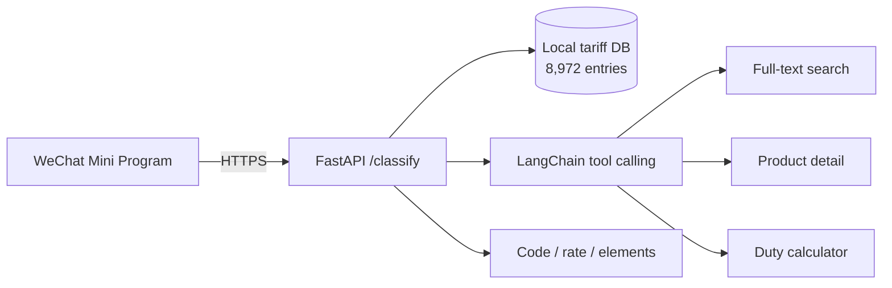

# HS Code Assistant (English)

A WeChat Mini Program + FastAPI service for **China customs HS code classification**.

Input a plain-language product name (e.g. "stainless steel thermos"), get back:
- HS code
- duty rate
- required declaration elements

## Architecture



## Measured performance

| Metric | Value |
|---|---|
| Cold start | 2,450 ms |
| Business logic | 34 ms |
| Tariff entries | 8,972 |
| Live users | 18 |

The cold-start gap is `fastapi` import time, not business code — profiled and documented in the repo.

## Quick start

```bash
pip install -r requirements.txt
uvicorn backend.main:app --reload --port 8000
curl "http://127.0.0.1:8000/classify?q=stainless%20steel%20thermos"
```

## MCP tools

`search_hs_code`, `get_hs_detail`, `calc_tax` — callable by any MCP-capable agent.

## License

MIT
