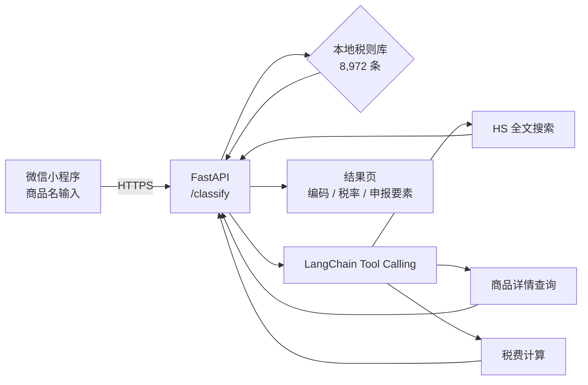

# 税则通 · HS Code Assistant

[](#)
[](#)
[](mcp/)

**微信小程序 + FastAPI**：输入商品口语名，返回归类编码、税率与申报要素。  
*A WeChat Mini Program + FastAPI backend that maps plain-language product descriptions to China customs HS codes, duty rates and declaration elements.*

---

## 为什么做这个

报关归类靠人查税则、靠经验判断。查错一个编码，整票可能退单。  
这个工具把「查编码 → 查税率 → 看申报要素」压缩成一次输入，3 秒内出结果。

## 架构



## 性能（实测）

| 指标 | 值 | 说明 |
|---|---|---|
| 冷启动 | **2,450 ms** | 容器首次请求 |
| 其中业务代码 | **34 ms** | 其余是 `fastapi` import 开销（瓶颈已定位） |
| 税则条目 | **8,972** | `data/hs_codes_full.json` |
| 线上用户 | 18 | 备案上线后自然增长 |

> 冷启动分析见 `_冷启动分析_20261021.md`：**98.6% 的时间花在框架 import，不在业务逻辑**。

## 快速开始

```bash
pip install -r requirements.txt
uvicorn backend.main:app --reload --port 8000
curl "http://127.0.0.1:8000/classify?q=不锈钢保温杯"
```

小程序端：用微信开发者工具打开 `miniprogram/`，把 `project.config.json` 的 `appid` 换成你自己的。

## MCP 能力

`mcp/` 目录把税则查询暴露成 MCP 工具，可被任意 Agent 调用：

- `search_hs_code(query)` — 全文搜索 8,972 条税则
- `get_hs_detail(code)` — 商品详情
- `calc_tax(code, price, origin)` — 税费计算

## 目录

```
hs-code-assistant/
├── backend/          FastAPI 服务
├── miniprogram/      微信小程序
├── mcp/              MCP 工具封装
├── data/             税则库（8,972 条）
└── Dockerfile        部署用
```

## 部署

见 `DEPLOY.md`。要点：容器内 `data/` 必须显式 COPY，否则 `dirname(__file__)/data` 找不到。

## License

MIT
